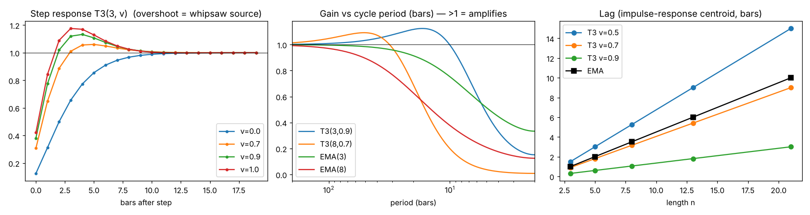

# 0. How this was produced

- **Research zip:** 19 PDFs + 10 curation files (`_SOURCES.md`). All 19 PDFs were extracted with **PyMuPDF 1.28 / pymupdf4llm** (layout-aware markdown, raw text, tables, every embedded image, page renders of every page with figures). One PDF (LeBaron 1995) is a scan with no text layer and was **OCR'd with Tesseract 5.3.4 at 300 dpi**. Equations stored as images were read from page renders and transcribed by hand.
- Every paper was **read in full**. Long proofs in the pure-math execution papers (Guo; Horst; Cartea appendix) were skimmed. Per-paper notes are saved in `research/notes/`, and the extracted text, images and tables are in `research/extracted/`.
- **Your script** `T3_Entry_Lab_Phase0_AUDITED.pine` was read line by line. The 206 rule expressions were parsed mechanically (not by eye) to get the rule structure.
- **Online research** filled gaps the zip does not cover (T3 origin, DSR/PBO, stop-loss theory, intraday futures evidence, TradingView fill mechanics, OHLC volatility, regime tests, order-flow proxies). Sources are in §8. The PSR formula was cross-checked against the `quantstats` source code.
- **No backtest was run on your data**, as instructed. The only computations in this document are pure mathematics: the filter response of the T3 formula, and the Bailey MinBTL / expected-maximum-Sharpe formulas.

# 1. Executive summary — the 15 things that matter most

1. **Your T3(3, 0.9) is almost the price itself.** Its lag is **0.30 bars** (exact: lag = 3(1−v)(n−1)/2). The step response **overshoots by 13.3%** and amplifies 12–17-bar cycles by 12%. On a pure random walk, price crosses it on **38% of bars**, more often than an EMA(3) (33%). Most "crosses" are therefore noise events, not trend events.
2. **The "neutral" triple barrier is a 1:1 coin-flip test.** With TP = SL = 1×ATR and no edge, P(TP first) = SL/(SL+TP) = **50%**. The expected exit time is about SL·TP/σ² ≈ **2.5 bars** (1 ATR ≈ 1.6σ per bar). Your **16-bar time limit almost never triggers**. The test therefore measures roughly 2–3 bars of drift minus costs. Vanstone (2008) measured **2.74 bars average holding** for a 1×ATR stop on an MA-cross entry: the same number, found independently.
3. **The 1×ATR stop is the single worst cell in the evidence.** Vanstone: an MA-cross system's Sharpe drops from **+0.50 to −3.27** with a 1×ATR stop (statistically worse, F = 8.476). Kaminski & Lo: under a random walk, stops **always** reduce expected return; they help only when returns have momentum.
4. **Multiple testing dominates everything.** 103 IDs × 2 directions = **206 trials**. With zero true edge, the best of 206 is expected to show a Sharpe of **2.78 standard deviations** of pure luck. Keeping that luck down to SR = 1 needs at least **7.7 years** of data (Bailey MinBTL). Adding a grid of T3 length × VF × TP × SL × maxBars multiplies N; at 263,680 trials you would need about 21 years.
5. **The 103 rules are a pre-selected subset.** They are 9 base rules × an irregular subset of 18 filters (94 of 162 possible combinations). If that subset was chosen after looking at results, the true number of trials is ≥ 162 × 2 = 324, not 206. Report the true count.
6. **Filters are the classic overfitting engine** (Bailey 2014: "most Technical Analysis strategies rely on filters … extra caution is warranted"). Base + filter combinations create the selection bias, not robustness.
7. **There is no regime gate.** Every paper on technical-rule profitability (LeBaron, Scholz, Yuan, Luo, Arnade) shows the edge is **regime-dependent**. LeBaron: FX MA-rule profits disappeared (Sharpe ≈ 0.1) once central-bank intervention days were removed. Scholz: short MAs only win when lag-1 autocorrelation is positive. Index futures at sub-20-minute horizons are mostly **negatively** autocorrelated (bid-ask bounce).
8. **Volatility is forecastable (HAR) and regime-switching**, yet the script uses a lagging ATR(14) that **includes the signal bar's own range**. The barrier therefore widens exactly on breakout bars (pro-cyclical).
9. **Execution is state-dependent.** Around news, adverse slippage probability rises about 4× and its size about 6× (Cartea: p− 0.057 → 0.229). The session open overshoots and then partly reverts (Park; Camilleri; Bag). The script has **no session, time-of-day or news filter**, and **no costs coded**.
10. **Impulse candles often mark the end of aggressive flow.** Price impact partly reverts, by about 25–40% (Tóth/Bouchaud; Horst), so "BigRange / BigBody / FarT3" confirmations buy close to the temporary peak. Pullback-type entries are better grounded in microstructure.
11. **Gap filters must be checked against roll gaps and overnight reversal.** Continuous-contract rolls create fake gaps unless the data is back-adjusted (TradingView B-ADJ is **off by default**). Overnight moves are often reversed intraday (Camilleri: π < 0).
12. **Position sizing:** no "optimal f" exists ex-ante (Scholz: TWR is monotone in f across 10,000 paths; single-path optima are artefacts). f = 25% gave the best Sharpe in every scenario. Use fractional Kelly on **out-of-sample** p and b only.
13. **Evaluate with the right statistics:** per-trade R or ATR units, bootstrap or random-walk nulls (LeBaron, Brock et al.), **DSR**, **PBO via CSCV**, White Reality Check / Hansen SPA, and t > 3 (Harvey-Liu-Zhu). Do not use shuffled k-fold (Zhang 2022 is the negative example).
14. **The literature on intraday TA is sobering.** Marshall, Cahan & Cahan: 7,846 intraday rules showed no value after data-snooping correction. Sullivan, Timmermann & White: the best of 7,846 rules was insignificant out of sample. Positive intraday evidence exists only for **specific, theory-backed** patterns: intraday momentum (first half-hour → last half-hour, Gao et al. 2018), and noise-band breakouts with trailing stops (Zarattini et al. 2024).
15. **The script is technically clean.** The coefficients sum to 1, the ATR is lagged where it should be, tick rounding is correct, and the time barrier is counted correctly. The problems are in **research design**, not syntax.

# 2. Your Pine script — complete audit

## 2.1 What the script does (verified line by line)

| Block | Exact behaviour |
|---|---|
| `strategy()` | `pyramiding=0`, `calc_on_every_tick=false`, `process_orders_on_close=false` → signal at confirmed bar close, **market fill at next bar open**. Fixed 1 contract. **No commission/slippage set in code** (must be set manually in Properties every time → not reproducible). |
| Inputs | `entryId` 1–103, `dirMode` Long/Short, `t3Len`=3, `t3VF`=0.9, `atrLen`=14, `tpMult`=1, `slMult`=1, `maxBars`=16. |
| T3 | Six cascaded `ta.ema(·, n)` combined with c1..c4. **Coefficients verified: c1+c2+c3+c4 = 1** (unit DC gain). |
| Helpers | `atrv = ta.atr(14)` (RMA of true range, **includes the signal bar**), `hh3/ll3` = 3-bar highest/lowest, used as `[1]` (prior 3 bars, correct). |
| Rules | `switch entryId` long/short; 206 boolean expressions. Short side is a logical mirror of long in all 103 IDs (verified); ~55 short comments carry long-side names (labels only, logic correct — e.g. ID 26 "Slope3Up" is slope-down logic). |
| Entry | `goLong = Long and longCond and flat and barstate.isconfirmed and atrv>0`. |
| Barriers | `tpTicks/slTicks = round(mult·ATR/mintick)` at signal bar; `strategy.exit(profit, loss)` measured **from actual fill price**. |
| Time barrier | `entryBar` = first bar with position; `close_all` when `bar_index−entryBar ≥ maxBars−1` → fills at open of bar entry+maxBars. Correct count. |
| Plot | T3 coloured by slope; signal triangles. |

## 2.2 The T3 formula — what it really is

Tillson (TASC, Nov 1998): **GD(n, v) = EMA·(1+v) − EMA(EMA)·v** (v = 0 → EMA, v = 1 → DEMA); **T3 = GD(GD(GD(x)))**, a six-pole filter. Expanded:

T3 = c1·e6 + c2·e5 + c3·e4 + c4·e3, c1 = −v³, c2 = 3v² + 3v³, c3 = −6v² − 3v − 3v³, c4 = 1 + 3v + 3v² + v³.

Lag of EMA(n) = (n−1)/2 bars → lag of GD = (1−v)·(n−1)/2 → **lag of T3 = 3(1−v)(n−1)/2**. Tillson recommended **v = 0.7**: "using v < 1 cures the multiple-DEMA overshoot problem at the cost of some phase delay". Your v = 0.9 sits close to the overshooting end.

Filter measurements (computed from the exact formula, impulse/step response):

| Filter | Lag (bars) | Step overshoot | White-noise variance passed | Peak gain (at period) | Gain on 3-bar cycle | Gain on 5-bar cycle |
|---|---|---|---|---|---|---|
| **T3(3, 0.9) — yours** | **0.30** | **13.3 %** | 0.374 | **1.124 (≈17 bars)** | 0.21 | 0.47 |
| T3(3, 0.7) | 0.90 | 6.0 % | 0.286 | 1.025 | 0.17 | 0.37 |
| T3(5, 0.7) | 1.80 | 9.2 % | 0.177 | 1.062 | 0.05 | 0.13 |
| T3(8, 0.7) | 3.15 | 11.6 % | 0.116 | 1.092 | 0.01 | 0.04 |
| T3(13, 0.7) | 5.40 | 13.2 % | 0.075 | 1.115 | 0.00 | 0.01 |
| EMA(3) | 1.00 | 0 % | 0.333 | 1.000 | 0.38 | 0.52 |
| EMA(8) | 3.50 | 0 % | 0.125 | 1.000 | 0.14 | 0.21 |

Crossing frequency of price vs line on a pure random walk (share of bars where the sign of close−line flips): **T3(3,0.9) 37.9 %**, T3(3,0.7) 34.5 %, EMA(3) 33.3 %, T3(5,0.7) 25.0 %, T3(8,0.7) 18.4 %, T3(13,0.7) 13.6 %, EMA(13) 17.2 %, T3(21,0.7) 10.1 %.



**Interpretation.** T3(3, 0.9) passes more white-noise variance (0.374) than an EMA(3) (0.333). It has a quarter of the lag but overshoots. "Close above T3" with n = 3 is roughly "the last bar closed above where the last 1–2 bars were". In other words, **1–2-bar momentum relabelled as a trend signal**. Scholz (2012) shows such ultra-short rules only work when lag-1 autocorrelation is positive. A larger n with v ≈ 0.7 gives an excellent smoother: much more noise suppression for a given lag than an EMA. Its cost is a 9–13% overshoot, which can create false "slope flips" after sharp reversals.

## 2.3 Structure of the 103 rules (parsed from your code)

| Base rule (ID) | Definition (long) | # combos present |
|---|---|---|
| BodyCross (1) | open < T3 and close > T3 | 14 |
| TwoCloseConfirm (2) | close > T3, close[1] > T3[1], close[2] ≤ T3[2] | 12 |
| PullbackHold (3) | T3 rising, low[1] ≤ T3[1] < close[1], close > high[1] | 11 |
| SlopeFlipAbove (4) | T3 > T3[1], T3[1] ≤ T3[2], close > T3 | 10 |
| WickReject (5) | close[1] > T3[1], low ≤ T3, open > T3, close > T3 | 15 |
| ThreeAbove (6) | 3 closes above after a close ≤ T3 | 14 |
| CleanCandle (7) | low > T3 and low[1] ≤ T3[1] | 12 |
| CrossThenHighBreak (8) | close[1] > T3[1], close[2] ≤ T3[2], close > high[1] | 10 |
| CloseCross (9) | close[1] ≤ T3[1], close > T3, **open ≥ T3** (= gap-cross, not a body cross) | 5 |

Filters used (count): CLV50 9, PrevInside 8, SmallRange 8, CLV75 7, GapUp 7, Slope3Up 7, LowerWick 7, BigRange 6, PrevBear 5, FarT3 5, CloseGt3High 5, NoUpperWick 5, BigBody 5, CloseGtPrevHigh 4, BullBar 3, NearT3 2, HigherLow 1.

**Findings on the rule set**

- **Irregular grid → probable selection bias.** 94 of 162 base × filter combinations are present, with no pattern (e.g. FarT3 is not tested on PullbackHold, NearT3 only on 2 bases). If the 94 were chosen after a screen, the effective N includes the screened-out ones.
- **The rules are highly dependent.** Every variant of a base rule fires on a subset of the base's bars, so they are nested, not independent. Bailey: estimate the effective N from the correlation of the trade-return series (PCA), and still report the raw N.
- **Contradictory pairs by design:** BigRange vs SmallRange, CLV75 vs CLV50, FarT3 vs NearT3. Testing both sides of every condition guarantees that one side "wins" by chance.
- **CloseCross (ID 9) is mislabelled.** It requires open ≥ T3, so it is a gap-through-T3 signal and mutually exclusive with BodyCross.
- **CLV / NoUpperWick on zero-range bars:** `high − max(o,c) ≤ 0.15·(high−low)` is trivially true when high = low (flat bar). This matters on thin overnight bars.
- **ATR usage is correct** where it matters (BigRange, FarT3 and SmallRange use `atrv[1]`), but the **barrier uses `atrv` of the signal bar**, which includes the signal bar's range.
- **GapUp / GapDown filters** (IDs 15, 24, 28, 30, 32, 43, 65) are sensitive to roll gaps (unadjusted continuous data) and to overnight reversal.

## 2.4 Execution and measurement issues

| # | Issue | Why it matters (evidence) | Severity |
|---|---|---|---|
| E1 | No commission/slippage in `strategy()` | Results depend on manual settings; not reproducible. LeBaron: Sharpe 0.689 → 0.155 as costs go 0 → 0.5%. | High |
| E2 | 1×ATR stop and 1×ATR target | Coin-flip barrier: E[τ] ≈ 2.5 bars, p = 50% under the null; Vanstone's worst cell. | High |
| E3 | maxBars = 16 almost never binds | The time barrier is cosmetic at 1:1 ATR, so the test has a single ~2–3-bar horizon. | Medium |
| E4 | Barrier ATR includes the signal bar | Pro-cyclical: wider stops on big bars and tighter ones on quiet bars, which distorts comparison across filters. | Medium |
| E5 | Intrabar order unknown on OHLC | TradingView assumes O→H→L→C if the open is nearer the high, else O→L→H→C. With 1-ATR barriers on 30-min bars, both levels are often inside one bar, so the outcome is decided by that assumption. Use Bar Magnifier or report ambiguous trades. | High |
| E6 | Gap through a level fills at next open | Real stop fills on gaps are worse than the level; your stop slippage must include gap risk. | Medium |
| E7 | No session / time-of-day / news filter | Open overshoot (Park), overnight reversal (Camilleri), news slippage ×4–6 (Cartea), intraday-momentum timing (Gao et al.). | High |
| E8 | No logging of MFE/MAE, R-multiple, bars held, exit type | You can't choose barriers non-arbitrarily without MAE/MFE (Vanstone's MAE histogram method). | Medium |
| E9 | No IS/OOS date inputs | Selection and evaluation happen on the same data. | High |
| E10 | Only win/loss implied | Wu et al.'s continuous label (+1 TP, −1 SL, time-exit P&L scaled to TP/SL) measures entry quality better. | Low–Med |

# 3. The research library — paper by paper

Each entry gives: **Hypothesis · Method & formulas · Key results · Critical assessment · What it means for T3.** (Notes with even more detail are in `research/notes/`.)

## 3.1 Bailey, Borwein, López de Prado, Zhu (2014): *Pseudo-Mathematics and Financial Charlatanism*. Notices AMS 61(5)

- **Hypothesis:** with enough configurations, a high in-sample Sharpe is guaranteed even with zero skill. If performance has memory, in-sample optimisation **hurts** out-of-sample results.
- **Formulas:** SR = (µ/σ)√q; ŜR → N[SR, (1 + SR²/(2q))/y]; **E[max_N] ≈ (1−γ)Z⁻¹[1−1/N] + γZ⁻¹[1−1/(Ne)]** (γ = 0.5772); upper bound √(2 ln N); annualised: × y^−½; **MinBTL ≈ (E[max_N]/target SR)²**, bounded by 2 ln N / E[max]²; AR(1) half-life = −ln 2 / ln φ.
- **Results:** N = 10 → expected maximum IS SR 1.57 with OOS 0. With 5 years of data, at most ~45 configs. An 8,800-node seasonal grid on a random walk gives SR 1.27 with PSR 2.83 (looks <1% likely to be luck, but it is pure noise). Memory makes the IS→OOS relation **negative**.
- **Assessment:** a foundational, correct and simple result. It directly prices your 206 trials.
- **For T3:** report N. Use DSR/PBO. Treat every added filter as a new trial. **MinBTL table (target SR = 1):** N = 103 → 6.5 years; N = 206 → **7.7 years**; N = 412 → 9.0 years; N = 1,648 → 11.5 years; N = 263,680 → 21.1 years.

## 3.2 Vanstone (2008): *Do initial stop-losses stop losses?* JASSA (4)

- **Hypothesis:** stops that look protective per trade do not improve portfolio risk or return.
- **Method:** 50-EMA cross, long only, day+1 market orders, ASX200 incl. delisted, 2000–07, $20 per side. Stops at 1–10% and 1–5×ATR. ANOVA on monthly returns.
- **Results:** no stop: 15,073 trades, Sharpe 0.50, 15.85 days. % stops: Sharpe 0.25 … 0.53, never better (F(10,1012) = 0.097). **ATR stops 1–5×: Sharpe −3.27, −0.77, −0.32, 0.06, 0.29**; trades last 2.74 → 10.53 days; 1×ATR significantly worse (F(5,552) = 8.476).
- **Assessment:** one system and one market, but the pattern matches theory (Kaminski-Lo).
- **For T3:** your default is the worst cell. Barriers must be tested as a grid that includes **wide / no stop**, judged at portfolio level, and chosen from MAE/MFE distributions.

## 3.3 Docherty, Dong, Song, Tippett (2017): *The Feller diffusion, filter rules and abnormal returns*. Eur. J. Finance

- **Hypothesis:** the assumed price process changes the measured "abnormal" return. Assuming GBM when prices follow a Feller diffusion produces fake drift.
- **Formulas:** Feller dx = µx dt + σ√x dW; GBM E[log] = µt − ½σ²t. **Two-barrier problem (exact = your TP/SL):** ½σ²x u'' + µx u' = 0, u(a) = 0, u(b) = 1 ⇒ **P(TP first) = [e^(−2µx/σ²) − e^(−2µa/σ²)] / [e^(−2µb/σ²) − e^(−2µa/σ²)]**; mean exit time from ½σ²x υ'' + µx υ' = −1.
- **Results:** expected abnormal log return over the barrier holding time is **zero** for a random process. Barriers do not create edge, and the measurement method can.
- **For T3 (arithmetic-BM limit):** P(TP first) = SL/(SL+TP) with zero drift; with drift µ per bar: P = (1 − e^(−2µSL/σ²)) / (1 − e^(−2µ(SL+TP)/σ²)); **E[τ] = SL·TP/σ²**; break-even win rate with round-trip cost c (ATR units): **p* = (SL + c)/(SL + TP)**.

## 3.4 LeBaron (1996): *Technical Trading Rule Profitability and FX Intervention*. NBER WP 5505 (scan → OCR)

- **Hypothesis:** MA-rule profits in FX come from days when the Fed intervenes.
- **Formulas:** ma = (1/M)Σ P (M = 150 daily, 30 weekly; chosen a priori); s = ±1 for P vs ma; r = s·(Δp − interest differential); annual SR ≈ √N µ/σ; bootstrap of scrambled returns (500 paths) as the null; GARCH(1,1) control.
- **Results:** full sample t = 2.6–3.5, SR 0.6–1.08, bootstrap p ≤ 0.014. Costs 0 → 0.5%: DM SR 0.689 → 0.155. **Removing intervention days: DM SR ≈ 0.1**, insignificant. Signal-vs-intervention sign agreement 0.81–0.87. 1981–84 non-intervention period: no edge. Removing the top-10% volatility days does not kill the edge.
- **For T3:** an MA edge, when real, is **conditional on a participant creating persistence**. In futures that means macro/central-bank days, session opens and trend regimes. Test conditional on regime. Pick conventional parameters a priori. Low turnover helps.

## 3.5 Yuan (2025): *Short-term returns … Markov regimes*. Series of Conf. J.

- **Model:** MS-VAR(1) r_t = µ_S + A_S r_{t−1} + ε, ε ~ N(0, Σ_S); Kim–Hamilton filter; r̂ = Σ P(S = s)µ_s; CVaR (Rockafellar–Uryasev) CVaR_α = min_η{η + Σ max(0, L_i − η)/((1−α)M)}; shrinkage Σ_ρ = (1−ρ)Σ + ρ diag Σ.
- **Results (reported):** states bull 28% / bear 20% / range 52%; self-transition 0.89 / 0.81 / **0.94**. SR 0.64 vs 0.35 EW; MaxDD 12.8% vs 28.4%.
- **Assessment:** **internally inconsistent** (the method says 2 states, the results report 3). λ and γ were selected using OOS drawdown, which is leakage. Use the ideas only.
- **For T3:** range regimes dominate and persist. A cross rule is a trend tool, so it needs a regime gate. A portfolio drawdown breaker is where stops belong.

## 3.6 Scholz (2012): *Size matters! Position sizing and timing strategies*. CPQF WP 31

- **Method:** 10,000 GBM/AR(1) paths × 2,500 days; SMA 5–200; sizing erratic vs f ∈ {25…125}%. Kelly x_K = (µ − r_f)/σ². Drift correction µ_a = µ_e + ½σ²; AR: µ_a = µ_e(1−φ), σ_a² = σ_e²(1−φ²).
- **Results:** **no optimal f ex-ante** (TWR is monotone in f; single-path optima are artefacts; ~38% of single paths look concave). **f = 25% has the best Sharpe in every scenario.** Short SMAs win only with φ > 0 and suffer whipsaw with φ < 0; SMA(38) is the pivot.
- **For T3:** measure φ (lag-1 autocorrelation) and the variance ratio per symbol and timeframe first. A T3(3) cannot work where φ < 0. Express results in R or ATR units. Never optimise f in-sample.

## 3.7 Luo, Klein, Ji, Hou (2019): *Infinite-HMM HAR for commodity futures RV*. IJF

- **Formulas:** RV = Σr²; BPV = µ₁⁻²Σ|r_j||r_{j+1}| (µ₁ = √(2/π)); jump J = I{Z > Φ_α}(RV − BPV)⁺ with the Huang-Tauchen Z using tri-power quarticity; **HAR: RV_t = a0 + a_d RV_{t−1} + a_w RV̄_5 + a_m RV̄_22 + u**; HAR-CJ, HAR-TCJ, HAR-ΔJ; X_spec = Vol/OI; Mincer–Zarnowitz R², MAFE, Model Confidence Set; utility w = r̂/(γσ̂²).
- **Results:** 5 Chinese ag futures, 5-min, 2011–15. Regime-switching HAR beats HAR (MCS 25%). The speculation ratio predicts vol. ~30 coefficient regimes, so parameters are not stable.
- **For T3:** volatility is predictable and regime-switching. Size barriers with **forecast** vol (HAR on OHLC range estimators) instead of ATR(14). Use jump-robust measures after spikes.

## 3.8 Liu & Maheu (2009): *Forecasting RV: Bayesian model averaging*. J. Applied Econometrics

- **Formulas:** RPV(p) = m^(p/2−1) µ_p⁻¹ Σ|r|^p; RBP; J = log(RV − RBP + 1); HAR-log; range = log(H/L) (Alizadeh-Brandt-Diebold); predictive likelihood; BMA weight ∝ p(y_T | M_k)·p(M_k | Y_{T−1}); Kass–Raftery 2 log BF scale.
- **Results:** |r|^p with p ≈ 1–1.4 is more persistent than r² (corr 0.67). Range beats r². BMA is best or near-best in 9/9 cases. No single model dominates.
- **For T3:** with OHLC, use range/absolute-value vol measures. **Model risk lesson:** don't crown one of 103 rules; ensemble the robust survivors.

## 3.9 Zhang (2022): *LightGBM + NN for high-frequency RV*. ICFIED

- Order-book features (WAP_n = (Bid·AskSize + Ask·BidSize)/(BidSize + AskSize), spreads, imbalance). RMSE 0.0021 → 0.0012.
- **Assessment:** shuffled 5-fold CV on a time series (leakage) and classification metrics on a regression target. Not trustworthy. Needs L2 data you don't have.
- **For T3:** a negative example. Use only purged / embargoed walk-forward validation.

## 3.10 Tóth, Lempérière, Deremble, de Lataillade, Kockelkoren, Bouchaud (2011): *Anomalous price impact*. PRX

- **Formulas:** **square-root law Δ = Yσ√(Q/V)**, δ ∈ [0.4, 0.7] (CFM futures: 0.5 small-tick, 0.6 large-tick); linear latent book V(p) = b|p − p0| ⇒ Δ = √(2Q/b); sign autocorrelation C(ℓ) ~ ℓ^−γ (futures γ ≈ 0.8); diffusivity σ²(ℓ) = ⟨(p_{t+ℓ} − p_t)²⟩/ℓ; post-metaorder plateau Δ∞/ΔT ≈ 0.75 (fair price 2/3).
- **For T3:** a 1-lot order has no impact, but **stops fill into a thin book**. Impulse bars partly revert, so prefer pullback entries. The variance-ratio / diffusivity gauge is the OHLC regime test.

## 3.11 Cartea & Sánchez-Betancourt (2022): *Optimal execution with stochastic delay*. Finance & Stochastics

- **Model:** S_t = S_0 + σW_t plus flicker ζ (p0, p+ ~ Exp(η+), p− ~ Exp(η−)); exponential latency; HJB-QVI; SPI = I(L − M)/tick.
- **Results (LMAX FX):** 57% of marketable limit orders miss. The latency-optimal strategy beats TWAP by $2.6–5.1/€M normally and **$7–36/€M around news**. Flicker p− rises from 0.057 to **0.229** in the ±1 minute around news.
- **For T3:** slippage is state-dependent. Use a news-minute filter. A guaranteed-fill backtest is optimistic.

## 3.12 Guo & Zervos (2015): *Optimal execution with multiplicative impact*. SIFIN

- dX = µX dt + σX dW − λX∘dξ^s + λX∘dξ^b; no manipulation if and only if µ = 0; with C_s = 0, sell immediately, v = (x/λ)(1 − e^(−λy)); free boundary F°.
- **For T3:** low relevance. Exits are an optimal-stopping problem with state-dependent boundaries, and edge means conditional drift.

## 3.13 Horst & Kivman (2024): *Execution under small impact, semimartingale strategies*. Finance & Stochastics

- Transient impact dY = −ρ_t Y dt + γ dX with stochastic resilience; as η → 0, the optimal inventory becomes a semimartingale with block trades at both ends (quadratic BSDE).
- **For T3:** low relevance. Impact is **transient** and decays at a variable rate, which supports mean reversion after aggressive bars.

## 3.14 Rosenberg & Traub (2009): *FX futures vs spot price discovery*. J. Derivatives

- Quote rule / tick rule to sign trades; Evans–Lyons Δs = β·OF; 3-minute lead–lag; VECM; Hasbrouck information shares; Gonzalo–Granger weight 1/(1 + a2/a1).
- **Results:** 1996: futures led spot by up to 12 minutes (info share 80–96%). 2006: spot dominated (GG 83–89%). Leadership changes with market structure.
- **For T3:** a leader market's state (pulled via `request.security`) is OHLC-usable confirmation, but lead–lag relations decay. Information concentrates in RTH and around 8:30 ET.

## 3.15 Arnade & Hoffman (2015): *Price variability and cash/futures relationships*. JAAE

- P_cash = c + βP_fut + u; ECM ΔP = γu_{t−1} + θ(u_{t−1}·vp_{t−1}) + lags; vp = lagged 12-day variance; half-life ln 0.5 / ln(1 + γ); Schwarz–Szakmary weights.
- **Results:** half-lives of 13–230 days by regime; futures discovery weight 0.48 → 1.0 → 0.58 (beans), 0.72–0.86 (meal). Three structural regimes in 20 years. Rolls handled without differencing across the roll.
- **For T3:** **use back-adjusted continuous data** (B-ADJ), report results per sub-period, and use lagged vol as an interaction (signal × vol).

## 3.16 Camilleri & Green (2009): *Suspension of call auctions, NSE India*. IJBAAF

- **Formulas:** **SIDP D = (H − L)/O**; **overnight reversal r_day = a + π r_overnight** (π < 0 = excess volatility); relative return dispersion; volume per |r|; event-study CAR with bootstrap.
- **Results:** after suspension, intraday vol fell but overnight reversal rose; first-hour 1-min autocorrelation fell; daily autocorrelation flipped sign (– → +).
- **For T3:** open and overnight dynamics are a distinct state. Estimate π on your symbols before using gap filters, and keep separate RTH/ETH statistics.

## 3.17 Park & Ahn (2023): *Opening auction time reduction, KRX* (Korean)

- **Formulas:** unbiasedness regression (V_open − P_c)/P_c = α + β_t (I_t − P_c)/P_c (Biais-Hillion-Spatt); **WPC = Σ_i (|ΔP_i|/Σ|ΔP_j|)(ΔP_{i,k}/ΔP_i)** (Barclay–Warner).
- **Results:** β ≈ 0.96–0.97 at the open. The first 15 minutes' WPC went from 46% to 79% after the change, with **overshoot and a negative WPC in the last 5 minutes**.
- **For T3:** session opens overshoot and then correct. Exclude or separately test the first bars, and use a WPC-style analysis to find *when* your symbol trends.

## 3.18 Bag & Goel (2023): *Weak form of call-auction prices, Monte Carlo*. Capital Markets Review

- GBM residual t-tests; Cholesky multivariate log-normal MC (Σ = CᵀC). Only 30 days of data and an ad-hoc |ρ| ≥ 0.3 "significance" rule. Weak.
- **For T3:** a Monte Carlo null must keep vol clustering and cross-correlation (i.i.d. MC understated dispersion by about 75%). Use block / stationary bootstrap.

## 3.19 Wu, Wu, Hung, Hassan, Fortino (2020): *Index futures → options via LSTM and Kelly*. NCA

- **The TAIEX strategy is the same triple-barrier design as your Lab** (TP/SL in points plus a time exit). It uses a continuous label: +1 TP, −1 SL, time exit = PnL/TP or PnL/SL. Kelly: G(f) = p ln(1 + b1 f) + (1−p) ln(1 − b2 f), **f\* = p/b2 − (1−p)/b1** (p = 0.464, b = 2 → 0.196; fair coin with odds 2 → 25%).
- **Results:** a single 4-month COVID test window and no costs. Outcomes swing from +247% to −84% depending on dropout and training length. Unreliable.
- **For T3:** use the continuous label. Kelly only with out-of-sample p and b, at a fraction.

# 4. Cross-paper comparison

| Theme | Papers that agree | Consensus | Implication for your Lab |
|---|---|---|---|
| Overfitting / selection bias | Bailey; Liu-Maheu (model risk); Scholz (single-path artefacts); Yuan & Wu & Zhang (negative examples) | The best of many configs is inflated; single-path optima are artefacts | Count trials, DSR, PBO, ensembles |
| Stops | Vanstone; Docherty; Kaminski-Lo (web) | Stops reduce expectancy unless returns have momentum; tight ATR stops are worst | Test wide or no stops; stops at portfolio level |
| Regimes | LeBaron; Yuan; Luo; Arnade; Scholz (φ); Tóth (diffusivity) | Edges and vol parameters are regime-dependent and persistent | Regime gate before the entry rule |
| Volatility | Luo; Liu-Maheu; Arnade | Vol is forecastable (HAR), clustered, jump-prone; range/abs measures are better | Forecast-vol barriers; jump-robust ATR |
| Microstructure / opens | Camilleri; Park; Bag; Rosenberg; Cartea | Opens overshoot and revert; info concentrates in RTH; costs spike at news | Session and news filters; state-dependent costs |
| Impact / flow | Tóth; Horst; Guo; Rosenberg | Impact is concave and transient; flow has long memory | Prefer pullbacks; order-flow proxies from OHLCV |
| Sizing | Scholz; Wu | Fractional, out-of-sample Kelly; f ≤ ½ Kelly | Size in R; vol-target |
| Statistics | LeBaron (bootstrap); Camilleri (bootstrap CAR); Luo (MCS) | Fat tails → bootstrap and model-confidence sets | Bootstrap nulls per rule |

**Where they disagree or are weak:** Yuan and Wu report large gains, but both have leakage or single-window tests. Zhang's metrics are invalid. Bag's inference is ad hoc. Rank the evidence: Bailey, Tóth, LeBaron, Scholz, Luo, Liu-Maheu and Cartea are strong; Vanstone and Docherty are moderate; Yuan, Wu, Zhang and Bag are weak.

# 5. Formula sheet (everything worth keeping)

**Filters / trend**

- EMA: e_t = αx_t + (1−α)e_{t−1}, α = 2/(n+1), lag (n−1)/2
- GD(v) = (1+v)EMA − v·EMA(EMA); **T3 = GD³**, lag 3(1−v)(n−1)/2; c1..c4 as in §2.2
- Kaufman efficiency ratio ER = |C_t − C_{t−n}| / Σ|C_k − C_{k−1}|; KAMA SC = [ER(fast − slow) + slow]²
- Ehlers SuperSmoother (2-pole Butterworth): a = e^(−√2π/P), c2 = 2a cos(√2π/P), c3 = −a², c1 = 1 − c2 − c3; y = c1(x + x₋₁)/2 + c2 y₋₁ + c3 y₋₂

**Volatility (OHLC)**

- True range TR = max(H − L, |H − C₋₁|, |L − C₋₁|); Pine ATR = RMA(TR)
- Parkinson σ² = (ln H/L)²/(4 ln 2); Garman–Klass σ² = ½(ln H/L)² − (2 ln 2 − 1)(ln C/O)²
- Rogers–Satchell σ² = ln(H/C)ln(H/O) + ln(L/C)ln(L/O) (drift-free); Yang–Zhang σ² = σ²_overnight + kσ²_open-close + (1−k)σ²_RS, k = 0.34/(1.34 + (n+1)/(n−1))
- Efficiency vs close-to-close ≈ Parkinson 5.2, GK 7.4, RS 8.0, YZ 14; E[H − L] = √(8/π)σ ≈ 1.596σ (Brownian)
- HAR: σ²_t = a0 + a_d σ²_{t−1} + a_w σ̄²_5 + a_m σ̄²_22 (+ jump / continuous split); HAR-log variant
- BPV = µ₁⁻²Σ|r_j||r_{j−1}|, µ₁ = √(2/π); J = (RV − BPV)⁺

**Regime / efficiency tests**

- Variance ratio VR(q) = Var(r_t + … + r_{t−q+1})/(q Var r); Z = (VR − 1)/√(2(2q−1)(q−1)/(3qn)); robust Z\* = (VR − 1)/√θ̂
- Diffusivity σ²(ℓ)/σ²(1) (Tóth); lag-1 autocorrelation φ; AR(1) half-life −ln 2/ln φ
- Overnight reversal r_RTH = a + π r_gap; SIDP (H − L)/O
- Markov switching: r = µ_S + A_S r₋₁ + ε, P(S_t | F_t) by Hamilton filter

**Barriers / exits**

- P(TP first) driftless = SL/(SL + TP); with drift µ: (1 − e^(−2µSL/σ²))/(1 − e^(−2µ(SL+TP)/σ²))
- E[τ] = SL·TP/σ² (driftless); break-even p* = (SL + c)/(SL + TP)
- Continuous barrier label (Wu): +1 TP, −1 SL, time exit = PnL/TP if > 0 else PnL/SL

**Sizing**

- Kelly (binary) f\* = p/b2 − (1−p)/b1; with b2 = 1: f\* = (p(1+b) − 1)/b; continuous x_K = (µ − r_f)/σ²; use ≤ ½ Kelly
- Vol target: contracts = (risk budget) / (k·σ_forecast·point value)

**Statistics / validation**

- PSR(SR\*) = Φ[(ŜR − SR\*)√(T−1) / √(1 − γ₃ŜR + (γ₄−1)/4·ŜR²)]
- DSR: SR\* = √Var(SR_n)·[(1−γ)Φ⁻¹(1 − 1/N) + γΦ⁻¹(1 − 1/(Ne))]
- MinTRL = 1 + (1 − γ₃SR + (γ₄−1)/4·SR²)(z_α/(SR − SR\*))²; MinBTL ≈ (E[max_N]/SR_target)²
- PBO (CSCV): split T into S blocks, all C(S, S/2) IS/OOS splits, ω̄ = OOS rank of IS-best / (N+1), λ = ln(ω̄/(1−ω̄)), PBO = P(λ ≤ 0)
- Bootstrap null (Brock-Lakonishok-LeBaron): scramble returns, rebuild prices, rerun the rule, p = share ≥ actual
- White Reality Check / Hansen SPA for the best of many; Harvey-Liu-Zhu t > 3

**Microstructure**

- Square-root impact Δ = Yσ√(Q/V); WAP; quote / tick rule; **BVC: V_buy = V·t_ν(ΔP/σ_ΔP)**
- Hasbrouck info share; Gonzalo–Granger 1/(1 + a2/a1); WPC = Σ(|ΔP_i|/Σ|ΔP|)(ΔP_ik/ΔP_i)
- CVaR_α = min_η{η + E[(L − η)⁺]/(1 − α)}

# 6. What your T3 is missing, and what to optimize (prioritised, OHLC only)

**Priority A: research design (fix before trusting any number)**

1. **Hard-code costs** in `strategy()` (`commission_type`, `commission_value`, `slippage`) per symbol, plus an extra stop-slippage assumption. Show gross vs net.
2. **Add IS/OOS date inputs** and freeze rule selection to IS only. Report the number of trials N with every result, and evaluate the winner with **DSR** and **PBO (CSCV)**.
3. **Replace the single 1:1 ATR barrier** with a label-free **event study** first: forward returns in ATR units at horizons 1, 2, 4, 8, 16, 32 bars, plus the MFE/MAE distribution per base rule vs unconditional bars. Only then choose barriers, from MAE/MFE (Vanstone's method), including wide- or no-stop variants.
4. **Collapse the 206 trials:** test the **9 base rules** first, each against a bootstrap / random-walk null. Add filters only if they are motivated by theory (§3), are pre-registered, and survive OOS.
5. **Log per trade:** R multiple, bars held, exit type, MFE, MAE, session, hour, ATR percentile, regime state. Export the list of trades. Use the continuous [−1, 1] label.

**Priority B: the T3 itself**

6. **Use a larger length and Tillson's v ≈ 0.7.** From the response table, T3(5–13, 0.7) gives 1.8–5.4 bars of lag with 3–10× less noise than T3(3, 0.9). Choose n a priori from the cycle you want to trade, not by optimisation.
7. **Use the T3 slope (or the Ehlers SuperSmoother slope) as state, and a band for crossings.** Require |close − T3| > k·σ_forecast (a noise band, as in Zarattini's Noise Area) so that zero-crossings inside noise are ignored. This directly removes the 38% noise-crossing problem.
8. **Barrier vol:** use the HAR forecast or Yang-Zhang / Parkinson range vol, **lagged** (`[1]`) so the signal bar does not set its own stop. Add a jump-robust median-range option.

**Priority C: regime gates (the main missing ingredient)**

9. **Trend/noise regime:** rolling variance ratio VR(q) > 1 (trending) vs < 1 (mean-reverting), lag-1 autocorrelation φ, and Kaufman ER. Enable trend entries only in VR > 1 / ER-high states. Measure them per symbol and timeframe first.
10. **Volatility regime:** the forecast vol percentile and the vol-of-vol. Report entry statistics by vol tercile (Arnade: vol changes adjustment speed; Luo: regimes).
11. **Optional Markov / HMM state** (2–3 states on returns and range) as a slow filter, using the filtered (not smoothed) probability only, to avoid look-ahead.

**Priority D: session, time and news (from microstructure)**

12. **Session filter / separate stats:** RTH vs overnight (ETH), and the first N bars after the open (overshoot) vs the rest. Intraday momentum windows: first-30-minute direction as a day filter (Gao et al.).
13. **News-minute blackout** (CPI, NFP, FOMC, EIA for CL) and higher assumed slippage in those windows (Cartea).
14. **Gap logic:** estimate the overnight reversal coefficient π. Use back-adjusted data (B-ADJ), and never let a GapUp/GapDown filter fire on a roll gap.

**Priority E: OHLC-only order-flow and context proxies**

15. **Bulk Volume Classification** from OHLCV bars (accurate on 5-min-plus bars) → buy/sell imbalance as a confirmation instead of candle-shape filters. Use the close-location value (CLV) only as a crude proxy.
16. **Cross-market confirmation** (lead–lag via `request.security`), e.g. NQ vs ES, DX vs GC/SI, CL vs energy. Test that the lead–lag still exists before using it.
17. **Prefer pullback-type bases** (PullbackHold, WickReject) over impulse filters (BigRange, BigBody, FarT3), given transient-impact reversal.

**Priority F: sizing and risk**

18. **Size in risk units**: contracts = risk budget / (SL distance × point value). Use fractional Kelly (≤ ½) from OOS p and b, or vol targeting. Add a portfolio-level drawdown breaker instead of tight per-trade stops.

# 7. A validation protocol that cannot fool you

1. Fix the hypotheses (which base rules, which regime gates, which barriers) **before** looking at the data, and write N down.
2. Run diagnostics per symbol and timeframe: φ, VR(2/4/8/16), ER distribution, overnight π, vol regimes.
3. Event study per base rule vs unconditional bars (ATR-unit forward returns, MFE/MAE) on IS data.
4. Barrier choice from IS MAE/MFE. Then the triple barrier with costs and Bar Magnifier.
5. Statistics: bootstrap null p-value per rule; DSR with the true N; PBO via CSCV (S = 16); t > 3.
6. OOS: one look only. Report degradation (OOS/IS Sharpe) and results per sub-period and per regime.
7. Robustness: neighbouring parameters (n ± 2, v ± 0.1, k ± 0.25), other symbols, other timeframes. Accept only plateaus, not peaks.

# 8. Sources

**Zip (read in full):** Bailey et al. 2014 (doi:10.1090/noti1105); Vanstone 2008 (JASSA 4); Docherty et al. 2017 (doi:10.1080/1351847x.2017.1309328); LeBaron 1996 (NBER WP 5505); Yuan 2025 (SCJ 1(1)); Scholz 2012 (CPQF WP 31); Luo et al. 2019 (doi:10.1016/j.ijforecast.2019.08.007); Liu & Maheu 2009 (doi:10.1002/jae.1070); Zhang 2022 (doi:10.2991/aebmr.k.220307.473); Tóth et al. 2011 (doi:10.1103/physrevx.1.021006); Cartea & Sánchez-Betancourt 2022 (doi:10.1007/s00780-022-00491-w); Guo & Zervos 2015 (doi:10.1137/120894622); Horst & Kivman 2024 (doi:10.1007/s00780-024-00536-2); Rosenberg & Traub 2009 (doi:10.3905/jod.2009.17.2.007); Arnade & Hoffman 2015 (doi:10.1017/aae.2015.24); Camilleri & Green 2009 (doi:10.1504/ijbaaf.2009.022716); Park & Ahn 2023 (doi:10.26845/kjfs.2023.4.52.2.213); Bag & Goel 2023 (Capital Markets Review 31(1)); Wu et al. 2020 (doi:10.1007/s00521-020-05377-6).

**Web research:**

- Tillson T3: [TradingView tilsont3](https://ar.tradingview.com/scripts/tilsont3), [LuxAlgo T3](https://www.luxalgo.com/library/concept/t3.md)
- Deflated Sharpe: [SSRN 2460551](https://papers.ssrn.com/abstract=2460551); PBO: [SSRN 2326253](https://papers.ssrn.com/abstract=2326253), [R pbo package](https://cran.hafro.is/web/packages/pbo/readme/README.html)
- Kaminski & Lo: [MIT DSpace](https://dspace.mit.edu/handle/1721.1/114876)
- Gao, Han, Li, Zhou (2018): [WUSTL](https://profiles.wustl.edu/en/publications/market-intraday-momentum/)
- Zarattini, Aziz, Barbon: [SFI WP 24-97](https://www.sfi.ch/de/publications/n-24-97-beat-the-market-an-effective-intraday-momentum-strategy-for-s-p500-etf-spy)
- Harvey, Liu, Zhu: [NBER w20592](https://www.nber.org/papers/w20592)
- Marshall, Cahan, Cahan: [CXO summary](https://cxoadvisory.com/technical-trading/technical-analysis-anathema-to-the-academic-world)
- White RC / Hansen SPA: [EFMA 2008](https://www.efmaefm.org/0EFMAMEETINGS/EFMA%20ANNUAL%20MEETINGS/2008-Athens/papers/Wang5.pdf); STW 1999: [FMG DP303](https://www.fmg.ac.uk/sites/default/files/2020-11/dp303.pdf)
- Brock, Lakonishok, LeBaron 1992: [IDEAS](https://ideas.repec.org/a/bla/jfinan/v47y1992i5p1731-64.html)
- Moskowitz, Ooi, Pedersen: [SSRN 2089463](https://papers.ssrn.com/abstract=2089463)
- OHLC volatility: [bookdown OHLC measures](https://bookdown.org/jarneric/financial_econometrics/5.1-ohlc-measures.html)
- Variance ratio: [Lo-MacKinlay 1989](https://web.mit.edu/~alo/www/Papers/lo-mackinlay-89.html)
- Kaufman ER: [TA-Lib ER](https://ta-lib.org/functions/er.html)
- Ehlers: [MESA UltimateSmoother](https://mesasoftware.com/papers/UltimateSmoother.pdf)
- BVC: [SSRN 1989555](https://papers.ssrn.com/abstract=1989555), [Massot et al. 2018](https://acfr.aut.ac.nz/__data/assets/pdf_file/0016/222037/ROBERTO-Massot-Samarpan-and-Pascual-2018-BVC-and-NOF-Preliminary-and-incomplete.pdf)
- Heston, Korajczyk, Sadka: [arXiv 1005.3535](https://arxiv.org/pdf/1005.3535)
- TradingView: [Strategies docs](https://www.tradingview.com/pine-script-docs/concepts/strategies/), [Bar Magnifier](https://www.tradingview.com:443/support/solutions/43000669285-what-s-bar-magnifier-backtesting-mode/), [Back-adjustment](https://www.tradingview.com/support/solutions/43000685266)

# Appendix A: your Pine script (unchanged, as received)

```pine
@@PINE@@
```
